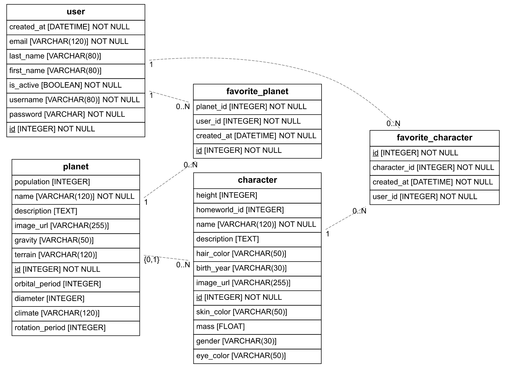

<a href="https://www.breatheco.de"></a>

# Plantilla de Flask para Desarrolladores Junior

Crea API's con Flask en minutos, [📹 mira el tutorial en video](https://youtu.be/ORxQ-K3BzQA).

- [Documentación extensa aquí](https://start.4geeksacademy.com).
- Integrado con Pipenv para la gestión de paquetes.
- Despliegue rápido a render.com o heroku con `$ pipenv run deploy`.
- Uso de archivo `.env`.
- Integración de SQLAlchemy para la abstracción de bases de datos.

## ⭐ Modelo de datos StarWars

Los modelos están en [`src/models.py`](src/models.py) y el diagrama UML en [`diagram.png`](diagram.png).



### Tablas

| Tabla | Para qué sirve | Campos principales |
|---|---|---|
| `user` | Usuarios del blog, que pueden iniciar sesión y guardar favoritos | `username`, `email`, `password`, `first_name`, `last_name`, `is_active`, `created_at` |
| `planet` | Planetas de StarWars | `name`, `climate`, `terrain`, `population`, `diameter`, `gravity`, `rotation_period`, `orbital_period`, `description`, `image_url` |
| `character` | Personajes de StarWars | `name`, `gender`, `birth_year`, `height`, `mass`, `hair_color`, `eye_color`, `skin_color`, `description`, `image_url`, `homeworld_id` |
| `favorite_planet` | Planetas favoritos de cada usuario | `user_id`, `planet_id`, `created_at` |
| `favorite_character` | Personajes favoritos de cada usuario | `user_id`, `character_id`, `created_at` |

### Relaciones

- **Usuario ↔ Planeta y Usuario ↔ Personaje (muchos a muchos):** un usuario puede guardar muchos planetas y personajes, y cada uno puede ser favorito de muchos usuarios. Las tablas `favorite_planet` y `favorite_character` conectan ambos lados. Cada una tiene una restricción única (`user_id` + `planet_id` / `character_id`) para que un usuario no guarde el mismo favorito dos veces.
- **Planeta → Personaje (uno a muchos):** un planeta puede ser el planeta natal (`homeworld_id`) de muchos personajes, y cada personaje tiene como máximo uno. Por eso el diagrama muestra `{0,1}` del lado del planeta.

### Cómo leer el diagrama

- Cada caja es una tabla y cada fila es una columna con su tipo (`INTEGER`, `VARCHAR`, etc.).
- `NOT NULL` indica que el campo es obligatorio.
- El `id` subrayado es la clave primaria.
- Las líneas discontinuas son relaciones entre tablas. `1` significa "uno", `0..N` significa "cero o muchos" y `{0,1}` significa "cero o uno".

### Cómo se generó el diagrama

El diagrama se generó con `eralchemy2`, la misma herramienta que usa `pipenv run diagram`, leyendo las tablas directamente de `src/models.py`. Para volver a generarlo con el comando oficial (necesita la base de datos PostgreSQL de Codespaces o Gitpod):

```sh
pipenv install
pipenv run migrate
pipenv run upgrade
pipenv run diagram
```

## 1) Instalación

Esta plantilla se instala en unos segundos si la abres gratis con Codespaces (recomendado) o Gitpod.
Omite estos pasos de instalación y salta al paso 2 si decides usar cualquiera de esos servicios.

> Importante: La plantilla está hecha para python 3.10 pero puedes cambiar la `python_version` en el Pipfile.

Los siguientes pasos se ejecutan automáticamente dentro de gitpod, si estás haciendo una instalación local debes hacerlos manualmente:

```sh
pipenv install;
psql -U root -c 'CREATE DATABASE example;'
pipenv run init;
pipenv run migrate;
pipenv run upgrade;
```

> Nota: Los usuarios de Codespaces pueden conectarse a psql escribiendo: `psql -h localhost -U gitpod example`

## 2) Cómo empezar a codificar

Hay una API de ejemplo funcionando con una base de datos de ejemplo. Todo tu código de aplicación debe escribirse dentro de la carpeta `./src/`.

- src/main.py (aquí es donde debes codificar tus endpoints)
- src/models.py (tus tablas de base de datos y lógica de serialización)
- src/utils.py (algunas clases y funciones reutilizables)
- src/admin.py (agrega tus modelos al administrador y gestiona tus datos fácilmente)

Para una explicación más detallada, busca el tutorial dentro de la carpeta `docs`.

## Recuerda migrar cada vez que cambies tus modelos

Debes migrar y actualizar las migraciones por cada actualización que hagas a tus modelos:

```bash
$ pipenv run migrate # (para hacer las migraciones)
$ pipenv run upgrade  # (para actualizar tu base de datos con las migraciones)
```

## Generar un diagrama de la base de datos

Si deseas visualizar la estructura de tu base de datos en forma de diagrama, puedes generarlo con el siguiente comando:

```bash
$ pipenv run diagram
```

Este comando generará un archivo con el diagrama de la base de datos basado en los modelos definidos en `src/models.py`.

## Verifica tu API en vivo

1. Una vez que ejecutes el comando `pipenv run start` tu API comenzará a ejecutarse en vivo y podrás abrirla haciendo clic en la pestaña "ports" y luego haciendo clic en "open browser".

> ✋ Si estás trabajando en una nube de codificación como [Codespaces](https://docs.github.com/en/codespaces/developing-in-codespaces/forwarding-ports-in-your-codespace#sharing-a-port) o [Gitpod](https://www.gitpod.io/docs/configure/workspaces/ports#configure-port-visibility) asegúrate de que tu puerto reenviado sea público.

## Publica/Despliega tu sitio web!

Esta plantilla está 100% lista para desplegarse con Render.com y Heroku en cuestión de minutos. Por favor lee la [documentación oficial al respecto](https://start.4geeksacademy.com/deploy).

### Contribuidores

Esta plantilla fue construida como parte del [Bootcamp de Codificación](https://4geeksacademy.com/us/coding-bootcamp) de 4Geeks Academy por [Alejandro Sanchez](https://twitter.com/alesanchezr) y muchos otros contribuidores. Descubre más sobre nuestro [Curso de Desarrollador Full Stack](https://4geeksacademy.com/us/coding-bootcamps/part-time-full-stack-developer), y [Bootcamp de Ciencia de Datos](https://4geeksacademy.com/us/coding-bootcamps/datascience-machine-learning).

Puedes encontrar otras plantillas y recursos como este en la [página de github de la escuela](https://github.com/4geeksacademy/).